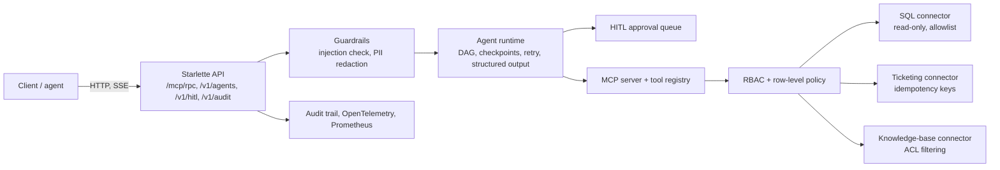

# Enterprise MCP Agent Platform

[](https://github.com/kishorhange111/enterprise-mcp-agent-platform/actions/workflows/ci.yml)


A multi-tenant Model Context Protocol (MCP) server and agent runtime built the way a Forward Deployed Engineer would ship it into a customer environment: every tool call is tenant-scoped, authorised, guarded, audited and evaluable.

**Author:** Kishor Hange

## Architecture



| Area | Module | What it does |
|---|---|---|
| Tenancy | `src/core` | Pydantic domain models, tenant context, per-customer YAML config (`configs/tenants/`) |
| Security | `src/security` | RBAC and row-level policies, PII redaction (Luhn-checked cards), prompt-injection guardrail |
| Tools | `src/mcp` | MCP server, JSON-schema-validated tool registry, SQL / ticketing / document connectors |
| Agents | `src/agent` | Checkpointed DAG runtime, structured-output validation with retry and fallback, human-in-the-loop approvals |
| Observability | `src/observability` | Immutable audit trail, OpenTelemetry tracing, Prometheus metrics |
| API | `src/api` | ASGI service with SSE streaming, `/healthz` and `/metrics` |
| Evaluation | `evals` | Agent trajectory and tool-call scoring against golden cases |
| Deployment | `Dockerfile`, `docker-compose.yml`, `deploy/k8s` | Non-root image, hardened compose, Kubernetes with HPA, PDB and network policy |

## Quickstart

```bash
pip install -e ".[dev,fastapi]"
make check                                   # lint + tests + coverage
uvicorn src.api.app:app --port 8000          # then: curl localhost:8000/healthz
docker compose up --build                    # or run it containerised
kubectl apply -k deploy/k8s                  # example manifests
```

## Quality and security evidence

- 94 % line coverage, enforced at 80 % in CI across Python 3.11-3.13, plus a container build with a `/healthz` and non-root check.
- A security red-team suite ([docs/security-redteam.md](docs/security-redteam.md)) attacks the SQL validator, injection detector and PII sanitiser on every run. It found and fixed an allowlist bypass (`FROM secrets AS s`) and comma-join gaps in the SQL connector.
- The prompt-injection detector is heuristic and misses several obfuscated attacks; those misses are tracked as strict `xfail` tests rather than hidden. It is one layer among RBAC, SQL validation and output redaction.
- Design decisions are recorded in [docs/adr](docs/adr).

## Limitations

- Connectors run against local or in-memory backends; no live Postgres, ticketing or search service is wired in this repository.
- The Kubernetes manifests are statically tested but have not been applied to a live cluster.
- No LLM is called by the platform itself; agents plug in through the runtime's step interface.
